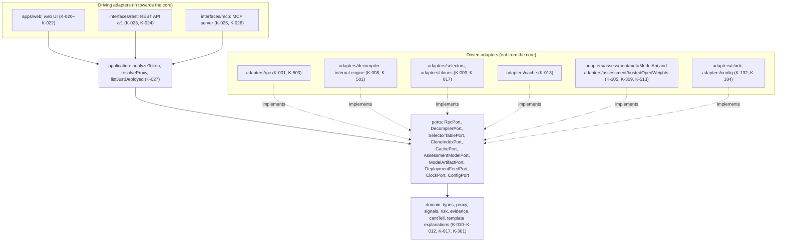

# Architecture Rules: Brandklipparen

Author: Jens Abrahamsson.
Status: final version for the build 27/10–4/11 2026.
Reading guide: the requirements (K-IDs) are owned by `docs/requirements.md`. This file owns
the architecture rules (A-xx). Infrastructure rules (I-xx) and the versioned
operational configuration are in `docs/infrastructure.md`. Threats with countermeasures
(H-xx, M-xx) are in `docs/threat-model.md`. Each A-rule is stated
positively and gives the K-IDs the rule realises. Traceability is checked
under K-405 and section 12.3 in `docs/requirements.md`.

## 1. Overview: hexagonal architecture

**A-01 Hexagonal structure.** The project is built hexagonally with named
modules: `domain` (pure functional core), `application`
(application services), `ports` (interfaces to the outside world, owned by
the core), driven adapters in `adapters/`, driving adapters in
`interfaces/` and `apps/web`, and `composition` as the single
wiring module. All logic for detection, proxy resolution,
signals, risk and template-based explanations lives in `domain` and is reached
through `application` (K-027).



**A-02 One shared application service.** `application` exposes three
deterministic services to all driving adapters: `analyzeToken` (fast path and
deepening under K-101), `resolveProxy` and `listJustDeployed`, plus the
on-request operation `requestAssessment` for the Muse contract
assessment per K-305 and K-309. `requestAssessment` sits outside the
deterministic analysis path: it runs solely after an explicit request,
after the deterministic result is computed and frozen, and it returns a
separate assessment field. The web UI, REST API and MCP server call the same service with the same typed
input and the same model version, so equal code hash and model version give
equal probabilities, scores and signals in every interface (K-027, K-102).

**A-03 One composition root.** `src/composition/root.ts` is the single
module with knowledge of concrete adapter classes. The root reads and
validates the configuration through `ConfigPort` (I-08), constructs each
adapter once, binds each port to exactly one adapter and hands a
ready `AppServices` structure to the driving adapters. Each
driving adapter receives `AppServices` through constructor injection.
The root selects exactly one `AssessmentModelPort` adapter from the
validated configuration per A-34: the Meta Model API adapter or the
hosted open-weights adapter. The startup test `a03_each_port_bound_to_exactly_one_adapter` verifies that
each port in the root is bound to exactly one adapter (K-027), and the
integration test `k309_config_selects_exactly_one_assessment_adapter`
verifies the selected provider and model id in the health response
(K-309).

## 2. Module boundaries and dependency direction

**A-04 Dependencies point inwards.** The import graph follows exactly this direction,
module by module:

| Module | Imports | Delivers to |
|---|---|---|
| `domain` | Own types and TypeScript standard types | `application`, `ports`, adapters (types only) |
| `ports` | `domain` (types only) | `application`, adapters |
| `application` | `domain`, `ports` | Driving adapters via `AppServices` |
| `adapters/*` (driven) | Its own port, `domain` (types only), its client library | `composition` |
| `interfaces/rest`, `interfaces/mcp` | `application` (service interfaces and types), `domain` (types only), its framework | `composition` |
| `apps/web` | The REST API's published schema and own UI types | The user's browser |
| `composition` | All modules above | The process entry point |
| `offline/` (Python) | Datasets in `offline/data`, the artifact format in `model/` | The versioned model artifact to `adapters/model` |

The driving web adapter talks to the core through the REST API, so
detection logic lives in one place and response equality under A-02 is measured
between REST, MCP and the shared service (K-027).

**A-05 Ports are owned by the core.** Each external capability is defined as a
port in `src/ports/` with the port's interface, the port's error union (A-15) and
the port's limits (A-17) collected in the same file. `domain` and
`application` talk solely with ports, and each adapter implements
its port. The ports are:

| Port | File | Responsibility | Requirements |
|---|---|---|---|
| `RpcPort` | `src/ports/rpc.ts` | Bytecode, storage, calls and block number against Ethereum mainnet | K-001, K-016, K-503, K-511 |
| `DecompilerPort` | `src/ports/decompiler.ts` | Decompilation of bytecode into functions and snippets | K-008, K-501 |
| `SelectorTablePort` | `src/ports/selectorTable.ts` | Local lookup of selector to name suggestion and risk relevance | K-009 |
| `CloneIndexPort` | `src/ports/cloneIndex.ts` | Code-hash and skeleton-hash matching against known templates | K-017 |
| `CachePort` | `src/ports/cache.ts` | Reading and writing of analysis results per code hash and model version, and assessment text per code hash, prompt version, provider and model id | K-013, K-305, K-309, K-511 |
| `AssessmentModelPort` | `src/ports/assessmentModel.ts` | Muse contract assessment with structured evidence through the selected provider, server-side only (I-13): Meta Model API (Muse Spark) or hosted open weights (Muse Spark Open, `meta-models/muse-spark-open-1026`) | K-305, K-309, K-302, K-307, K-502, K-513 |
| `InvestigationModelPort` | `src/ports/investigationModel.ts` | Opt-in investigation loop proposing the next registry-derived check through hosted open weights (Muse Spark Open, `meta-models/muse-spark-open-1026`), server-side only (I-13); `not-configured` without a key | K-036, K-520, K-307, K-502, K-513 |
| `ModelArtifactPort` | `src/ports/modelArtifact.ts` | Loading and checksum verification of the model artifact | K-011, K-210, K-211 |
| `DeploymentFeedPort` | `src/ports/deploymentFeed.ts` | Recently deployed tokens for the Just-deployed flow | K-014, K-015 |
| `ClockPort` | `src/ports/clock.ts` | Current time as a value to the core | K-102, K-104 |
| `ConfigPort` | `src/ports/config.ts` | Validated operational configuration as a typed value | K-008, K-503, K-505 |

The port signatures in TypeScript are normative; `Result` and the error unions
are defined in A-14 and A-15, and each call carries a `CallContext` with
correlation ID (I-10), absolute deadline (A-17) and block context:

```ts
type CallContext = {
  requestId: RequestId;
  deadline: Timestamp;
  block: BlockNumber | "latest";
};

interface RpcPort {
  getCode(address: Address, ctx: CallContext):
    Promise<Result<BytecodeResult, RpcError>>;              // K-001
  getStorageAt(address: Address, slot: Slot, ctx: CallContext):
    Promise<Result<StorageWord, RpcError>>;                 // K-002, K-003, K-005, K-016
  call(to: Address, data: CallData, ctx: CallContext):
    Promise<Result<CallData, RpcError>>;                    // K-003, K-006
  getBlockNumber(ctx: CallContext):
    Promise<Result<BlockNumber, RpcError>>;                 // K-102
}

interface DecompilerPort {
  decompile(bytecode: Bytecode, codeHash: CodeHash, ctx: CallContext):
    Promise<Result<DecompiledContract, DecompilerError>>;   // K-008
}

interface SelectorTablePort {
  lookup(selector: Selector): SelectorInfo;                 // K-009, synchronous and local
  knownProxySelectors(): readonly SelectorInfo[];
}

interface CloneIndexPort {
  match(codeHash: CodeHash, skeletonHash: SkeletonHash):
    Result<CloneMatch | null, CloneIndexError>;             // K-017
  indexVersion(): IndexVersion;
}

interface CachePort {
  get(key: CacheKey): Promise<Result<CachedAssessment | null, CacheError>>;
  put(key: CacheKey, value: CachedAssessment):
    Promise<Result<void, CacheError>>;                      // K-013
}

type AssessmentProvider = "meta-model-api" | "hosted-open-weights";

interface AssessmentModelPort {
  assess(evidence: EvidenceList, promptVersion: PromptVersion,
         ctx: CallContext):
    Promise<Result<MuseAssessment, AssessmentModelError>>;  // K-305, K-309
  provider(): AssessmentProvider;
  modelId(): ModelId;
}

interface ModelArtifactPort {
  load(version: ModelVersion):
    Result<ModelArtifact, ModelArtifactError>;              // K-210, K-211, verifies checksum
}

interface DeploymentFeedPort {
  listRecent(limit: PageSize, ctx: CallContext):
    Promise<Result<readonly DeploymentSummary[], FeedError>>; // K-014
}

interface ClockPort { now(): Timestamp; }                   // K-102
interface ConfigPort { config(): DriftConfig; }             // I-08, validated at startup
```

The `ApiKey` and quota check lives in the driving adapters and in
`application` as a typed step before the analysis (K-024, K-504, K-510);
the key lifecycle follows K-510 and I-09. Health per dependency (RPC,
cache, the internal decompiler and the selected assessment provider
per K-309, with provider and model id) is exposed through a
`health()` method on each driven adapter and is collected by the composition
root for the health check in K-104.

**A-06 Automatic boundary enforcement.** `dependency-cruiser` (pinned under
A-29) runs in the CI gate (I-01) with the configuration
`.dependency-cruiser.cjs` in the repo root. The configuration carries a named
rule per layer, and each rule violation turns the gate red:

| Rule in dependency-cruiser | Permitted direction |
|---|---|
| `boundary-domain-isolated` | `domain` imports solely `domain` |
| `boundary-ports-on-domain` | `ports` imports solely `domain` |
| `boundary-application-inward` | `application` imports `domain` and `ports` |
| `boundary-adapter-owns-one-port` | Each `adapters/<name>` imports its own port file, `domain` and its client library |
| `boundary-adapters-sibling-isolated` | All `adapters/<a>` stay separate from `adapters/<b>`; wiring happens in `composition` |
| `boundary-driving-via-application` | `interfaces/*` reaches the core through `application`; `apps/web` through the REST schema |
| `boundary-composition-wires-all` | `composition` is the single module that imports concrete adapter classes |
| `boundary-offline-exports-artifact` | `offline/` delivers solely artifact files under `model/` to the runtime |
| `boundary-domain-deterministic` | `domain` imports solely deterministic standard functions under A-32 |

CI runs `depcruise --validate .dependency-cruiser.cjs src apps` and
`tsc --noEmit` in the same gate step; both steps block merges
on violations (K-105, K-106). The CI test
`a06_deliberately_broken_boundary_fails_ci` fails a deliberately
broken module boundary, so the enforcement itself stays tested.

## 3. Deterministic core

**A-07 The core is a pure function.** Each function in `domain` is a pure
function of three inputs: the bytecode, the on-chain readings at a fixed
block number and the frozen calibration artifact under K-211. The same
triple input gives bit-identical output under A-32 on every run,
in every process and on every machine (K-102). Time, block number,
configuration and shared read data reach the core solely as
function parameters through the ports; core functions delegate all I/O
to the ports (K-102).

**A-08 Passed-in immutable values.** Shared read data (selector table,
clone index, model artifact) is passed in as a frozen value (`readonly` in
the type, sealed at load) to each core function. State lives
in the application services and the adapters; core functions take state
as a parameter and return new state as a value (K-102, K-210,
K-211).

**A-09 Immutable domain values.** Domain values are frozen at construction
(`Object.freeze` in the smart constructors, `readonly` in the types).
Each update constructs a new value. Property tests under
A-22 verify that an analysis leaves its inputs unchanged (K-102).

**A-32 Determinism rules for the core.** The core follows these rules, and
each rule has a named check in the suite:

1. **Clock as a parameter.** Core functions read the current time solely from
   the passed-in `Timestamp` parameter from `ClockPort`. Calls to
   the system clock in `domain` turn red in the rule
   `boundary-domain-deterministic` under A-06 and in
   the CI check `a32_domain_has_no_clock_random_or_network`.
2. **Randomness as a seeded parameter.** Randomness in the core comes solely from a
   seeded generator passed in as a parameter. Tests use
   seeded generators from `fast-check` with a fixed seed per test case.
3. **Network through ports.** Network calls happen solely in driven
   adapters behind ports. `domain` and `application` talk solely with
   the port interfaces in A-05, checked by A-06.
4. **Stable order.** Each collection that leaves the core is sorted on a
   stated key before serialisation: signals on `SignalId`,
   evidence on selector and `PcOffset`, facets on selector and address.
   Map and Set iteration in the core follows insertion order as
   established by the sorting.
5. **Canonical serialisation.** Output is serialised with canonical JSON:
   object keys in lexicographic order, arrays in the stable
   order under point 4, integers as decimal strings where the value
   exceeds the exactly representable range, and a fixed
   character encoding (UTF-8). The function `canonicalSerialize` in
   `src/domain/serialize.ts` is the single serialisation path for
   analysis results and for the artifact checksum under A-20.
6. **Floating point with fixed rounding.** `Probability` is stored and serialised
   with fixed precision: the value is rounded to a fixed number of decimals
   with a named rounding function (`Probability.ofRounded`) before
   storage, and each arithmetic step in the risk function follows the same order
   of operations on every platform. Serialisation writes the value
   in the same fixed form, so equal input gives bit-identical text.
7. **Version fields in every response.** Each response carries block number, code hash,
   model version, artifact checksum, index version and template version
   under K-102, so the output is reproducible exactly.

Determinism is tested in three layers under A-22: golden tests on frozen
fixtures with fixed expected serialised output
(`k102_golden_fixtures_bit_identical`), the bit-identity test
`k102_two_runs_across_processes_bit_identical`, which runs the same fixtures
in two separate processes and compares the output byte for byte, and
the property test `k102_same_inputs_bit_identical_outputs`. The job
`determinism` in the CI gate (I-01, I-16) runs all three layers.
(K-102, K-211)

**A-33 Template explanations in the core and the Muse contract
assessment outside the deterministic analysis path.** Template-based
explanations are built in `src/domain/explain.ts` as a pure function of
the evidence and the template version: the same evidence and the same
template version give bit-identical text under K-301 and A-32. The Muse
contract assessment lives outside the deterministic analysis path in
`application.requestAssessment`, behind `AssessmentModelPort` per A-34,
and runs solely after an explicit user request. `application` calls the
port first after probabilities, scores, signals and evidence have been
computed and frozen. The selected adapter receives the closed evidence
list under K-302, delivers a separate free-text assessment field, caches
assessment text per code hash, prompt version, provider and model id
under K-305 and K-309, and labels the response with provider and model
id. Each error branch in the adapter yields the template text under
K-306 as the standing explanation, with the assessment field stating
the fallback. The deterministic analysis path makes zero calls to
`AssessmentModelPort` ahead of an explicit request, verified by
`k102_analysis_path_makes_no_model_calls` and
`k305_no_assessment_call_until_user_requests_assessment`. The deterministic
core builds zero prompts and receives zero model output, so the core
carries zero prompt injection surface per K-502. (K-301–K-309, K-102,
K-502, K-513)

**A-34 Swappable assessment provider behind `AssessmentModelPort`.**
`AssessmentModelPort` in `src/ports/assessmentModel.ts` is the single
port for the Muse contract assessment. Two adapters implement the port:
`adapters/assessment/metaModelApi` calls Muse Spark through the Meta
Model API, and `adapters/assessment/hostedOpenWeights` calls Muse
Spark Open served on hosted with model id
`meta-models/muse-spark-open-1026`. Both adapters are MVP per K-309.
The composition root per A-03 reads the provider selection from the
validated configuration per I-08 and I-13 and binds exactly one adapter
to the port at startup; the demo default provider is the open decision
for Jens in section 13 of `docs/requirements.md`. Each adapter enforces
the same port limits per A-17: cost limit, timeout, input size limit
and output size limit, schema validation of the provider response and
cache per code hash, prompt version, provider and model id. Each
response carries provider and model id. Contract tests run the same
shared suite `runAssessmentModelPortContract` against both adapters and
a fake in `tests/fakes/`, with equal outcomes for success, timeout,
rate limit, invalid output, oversize output and unavailable provider.
Running the hosted adapter qualifies the project for the bonus prize
"Best Build on Meta Open Weight Models" per K-309. (K-305, K-309,
K-513, A-03, A-22, A-23)

**A-35 Opt-in investigation loop behind `InvestigationModelPort`.**
`InvestigationModelPort` in `src/ports/investigationModel.ts` is the
single port for the Investigate with Muse loop. One adapter implements
the port: `adapters/investigation/hostedInvestigateAdapter` calls Muse
Spark Open served on hosted with model id
`meta-models/muse-spark-open-1026`, plus a fake adapter in
`tests/fakes/` and a not-configured adapter bound when the key is
absent. The graph runner in `src/application/investigateToken.ts`
owns the typed state machine, the registry-derived read-only tool
catalogue and the hard limits; the model only proposes the next step.
`src/application/investigationService.ts` freezes the deterministic
result first and exposes the loop to REST (`POST /v1/investigate` plus
the `GET /v1/investigate/events` step stream), the `investigate_token`
MCP tool and the web UI graph. The loop never moves scores or evidence
(K-307): verified by
`k520_investigation_leaves_score_and_evidence_unchanged`. (K-036,
K-520, K-307, K-102, A-03, A-22, A-23)

## 4. Strongly typed domain

**A-10 Branded types with invariants.** Each central concept is a
nominal (branded) type with a smart constructor in `src/domain/types.ts`.
The constructor is the single entry path and returns
`Result<T, DomainError>` under A-14. The table is exhaustive for
the core's values:

| Type | Underlying | Invariant the constructor guarantees | Constructor |
|---|---|---|---|
| `Address` | `string` | `0x` followed by 40 hex characters, checksummed form stored | `Address.parse(raw)` |
| `Bytecode` | `Uint8Array` | Even hex length; length at most the operational limit in A-17 | `Bytecode.parse(hex)` |
| `CodeHash` | `string` | keccak256 of the bytecode with CBOR metadata removed (the glossary in `docs/requirements.md`) | `CodeHash.of(bytecode)` |
| `SkeletonHash` | `string` | Hash over the opcode sequence with PUSH operands and CBOR masked | `SkeletonHash.of(bytecode)` |
| `Selector` | `string` | Exactly 4 bytes hex (`0x` + 8 hex characters) | `Selector.parse(raw)` |
| `PcOffset` | `number` | Integer ≥ 0 and within the bytecode length | `PcOffset.of(offset, bytecode)` |
| `Slot` | `string` | Exactly 32 bytes hex (uint256) | `Slot.parse(raw)` |
| `CallData` | `Uint8Array` | Even hex length; selector in the first four bytes when the length permits | `CallData.parse(hex)` |
| `StorageWord` | `string` | Exactly 32 bytes hex (uint256) | `StorageWord.parse(raw)` |
| `Probability` | `number` | Number in [0, 1] with fixed rounding under A-32; NaN and infinity are turned away at construction | `Probability.of(value)`, `Probability.ofRounded(value)` |
| `RiskScore` | `number` | Integer in [0, 100] | `RiskScore.of(value)` |
| `ChainId` | `number` | Positive integer; the value for Ethereum mainnet is set in the configuration | `ChainId.of(value)` |
| `BlockNumber` | `number` | Integer ≥ 0 | `BlockNumber.of(value)` |
| `ModelVersion` | `string` | Semver form under the artifact format in A-20 | `ModelVersion.parse(raw)` |
| `IndexVersion` | `string` | Semver form, same format as `ModelVersion` | `IndexVersion.parse(raw)` |
| `TemplateVersion` | `string` | Semver form for the template version under K-301 | `TemplateVersion.parse(raw)` |
| `PromptVersion` | `string` | Semver form for the assessment prompt version under K-305 and K-309 | `PromptVersion.parse(raw)` |
| `ModelId` | `string` | Provider model identifier; the hosted value is `meta-models/muse-spark-open-1026` per K-309 | `ModelId.parse(raw)` |
| `ExplanationSchemaVersion` | `string` | Semver form for the explanation schema under K-305 | `ExplanationSchemaVersion.parse(raw)` |
| `ArtifactChecksum` | `string` | SHA-256 in hex, 64 characters | `ArtifactChecksum.parse(raw)` |
| `RequestId` | `string` | UUID form; generated at the boundary and follows the analysis (I-10) | `RequestId.generate(clock)` |
| `EvidenceId` | `string` | Stably derived from code hash, selector and PC offset | `EvidenceId.of(codeHash, selector, offset)` |
| `Timestamp` | `number` | Milliseconds since epoch, integer ≥ 0; delivered by `ClockPort` | `Timestamp.of(ms)` |
| `UntrustedText` | `string` | Contract string capped at the length limit in A-17 and marked as untrusted data (K-308) | `UntrustedText.quote(raw)` |
| `SignalId` | `string` | Stably derived from code hash and the evidence selector under K-010 | `SignalId.of(codeHash, selector)` |
| `CloneGroupId` | `string` | Stable group ID from the clone index under K-017 | `CloneGroupId.parse(raw)` |
| `CacheKey` | `string` | Composed of `CodeHash` and `ModelVersion`, so a new model version gives a new key (K-013) | `CacheKey.of(codeHash, modelVersion)` |
| `PageSize` | `number` | Positive integer within the page-size limit in A-17 | `PageSize.of(value)` |

Composite structures are built from the fields above and are validated field by
field by the same constructors: `Evidence` (selector, optional `PcOffset`,
optional snippet), `CodeSnippet` (text, marked line, selector),
`FacetMapping` (selector range, facet address, code hash),
`MeasuredValue` (value, slot, block, time point), `CantTellItem`
(question, required data source), `DeploymentSummary` (address, block,
deployment time, score), `SelectorInfo` (selector name or the status unknown,
risk relevance), `CloneMatch` (similarity, group, count), `UncertaintyFlag`
(reason from a closed set) and `RiskResult` (probabilities, score,
largest contribution per direction). `Severity` is the union `"low" | "medium" |
"high"` and `Direction` the union `"raises" | "lowers"`.

Type checking turns away mixing of these types at compile time,
and the unit tests for each constructor try the limits on both
sides of the invariant (K-106).

**A-11 Smart constructors at every boundary.** The principle is parse at
the boundary: driving adapters' input and driven adapters' responses
pass a smart constructor or a boundary check (A-16) before the value
reaches `application` or `domain`. After the boundary, each value carries its
proof of validity in its type, so core functions take validity as
given. An invalid address is turned away by `Address.parse` before the first
RPC call, which the unit test `k001_invalid_address_fails_before_rpc`
verifies with a call-counting fake (K-001, K-106).

**A-12 Discriminated unions.** The core's composite concepts are
discriminated unions with `kind` as discriminator. Each `switch` over
a union is exhaustive through a `never` check in the last branch, so a
new branch gives a type error at every matching site until the branch is handled
(K-106). The unions are normative:

```ts
// Proxy resolution (K-002–K-007). The Muse contract assessment follows the implementation,
// and each branch carries the authority to change the target.
type ProxyResolution =
  | { kind: "none" }
  | { kind: "eip1967"; implementation: Address; implementationCodeHash: CodeHash;
      admin: AdminKind; upgradeAuthority: UpgradeAuthority }          // K-002
  | { kind: "beacon"; beacon: Address; implementation: Address;
      implementationCodeHash: CodeHash; uncertainty: readonly UncertaintyFlag[] } // K-003
  | { kind: "eip1167"; target: Address; targetCodeHash: CodeHash;
      mutability: "fixed" }                                            // K-004
  | { kind: "uups"; implementation: Address; implementationCodeHash: CodeHash;
      upgradeFunction: Selector; upgradeAuthority: UpgradeAuthority }  // K-005
  | { kind: "diamond"; facets: readonly FacetMapping[];
      diamondCutAuthority: UpgradeAuthority }                          // K-006
  | { kind: "eip7702"; delegation: Address; delegationCodeHash: CodeHash;
      mutability: "changeable-by-new-authorization" };                 // K-007

type AdminKind =
  | { kind: "eoa"; address: Address }
  | { kind: "contract"; address: Address; codeHash: CodeHash }
  | { kind: "zero" };

type UpgradeAuthority =
  | { kind: "single-key"; holder: Address }
  | { kind: "contract"; holder: Address; codeHash: CodeHash }
  | { kind: "locked" };

// Signals (K-010). Each branch carries at least one Evidence under A-13.
type Signal =
  | { kind: "capability"; id: SignalId; risk: RiskType; direction: Direction;
      severity: Severity; temporality: Temporality; evidence: NonEmpty<Evidence> }
  | { kind: "clone-match"; id: SignalId; risk: RiskType; direction: Direction;
      severity: Severity; similarity: Probability; group: CloneGroupId;
      priorCount: number; evidence: NonEmpty<Evidence> }               // K-017
  | { kind: "hard-to-analyze"; id: SignalId; risk: RiskType;
      cause: "timeout" | "resource-limit" | "decompiler-error" | "obfuscated-structure";
      evidence: NonEmpty<Evidence> };                                  // K-008, K-501

type RiskType = "rug-pull" | "honeypot" | "bot-pump";
type Direction = "raises" | "lowers";
type Severity = "low" | "medium" | "high";

// Holds now and can change are separate branches (K-303, A-13).
type Temporality =
  | { kind: "applies-now"; measuredValue: MeasuredValue; block: BlockNumber; at: Timestamp }
  | { kind: "can-change"; changer: UpgradeAuthority | Address };

// Analysis result (K-011, K-012, K-101).
type Assessment =
  | { kind: "assessed"; target: Address; codeHash: CodeHash;
      proxy: ProxyResolution; probabilities: RiskProbabilities;
      score: RiskScore; signals: readonly Signal[]; cantTell: readonly CantTellItem[];
      modelVersion: ModelVersion; indexVersion: IndexVersion; block: BlockNumber }
  | { kind: "no-contract"; target: Address; reason: "no-code-at-address" }
  | { kind: "invalid-input"; error: DomainError };

type RiskProbabilities = Readonly<Record<RiskType, Probability>>;

type DeepeningStatus =
  | { kind: "pending" }
  | { kind: "complete"; snippets: readonly CodeSnippet[] }
  | { kind: "fallback"; reason: "timeout" | "resource-limit" | "invalid-output" | "unavailable" };

// Explanations (K-301–K-309). Template text is the default branch.
// The Muse contract assessment is a separate field beside Explanation.
type Explanation =
  | { kind: "template"; claims: readonly Claim[]; templateVersion: TemplateVersion };

type MuseAssessment = {
  text: string; claims: readonly Claim[]; promptVersion: PromptVersion;
  provider: AssessmentProvider; modelId: ModelId;
  explanationVersion: ExplanationSchemaVersion;
};

type Claim = {
  text: string; signalLinks: NonEmpty<SignalId>; temporality: Temporality;
};
```

**A-13 Invalid states are unrepresentable.** `Signal.create` requires a
`NonEmpty<Evidence>` where each `Evidence` carries at least one `Selector` and
carries `PcOffset` in every case where the offset is derived from the bytecode (K-010).
`Temporality` separates a measured holds-now state (value, block and time point) from
a future capability (authorised changer), so each capability in an explanation
expresses one of the branches (K-303, K-304). `Probability.of` and
`RiskScore.of` carry the range invariants in A-10, so probabilities and
scores keep their ranges through the whole chain (K-011). Items that can't tell
are carried as `CantTellItem` values in the result.

## 5. Error handling at boundaries

**A-14 Result types in the core.** `domain` and `application` return
`Result<T, E>` under the pattern
`type Result<T, E> = { ok: true; value: T } | { ok: false; error: E }`.
Core functions return `Result` for each expected error outcome and
reserve exceptions for broken internal invariants
(programming errors). Adapters catch external exceptions (network, process,
parsing) at the port boundary and translate them to the port's error union
(A-15) before the value moves on. Presentation of errors to users happens
in the driving adapters under A-18 (K-501).

**A-15 Error catalogue per port.** Each port owns a discriminated error union.
Timeout and resource excess are dedicated branches and are mapped in
`application` to domain outcomes: the decompilation timeout branch gives
the signal `hard-to-analyze` in the deepening while the fast path's response
stands (K-008). The catalogue is normative:

| Port | Error union (branches on `kind`) | Domain outcome in `application` |
|---|---|---|
| `RpcPort` | `timeout`, `rate-limited`, `node-error`, `invalid-response`, `no-code` | `invalid-response` gives an uncertainty flag (K-511); `no-code` gives the branch `no-contract` in `Assessment` (K-001) |
| `DecompilerPort` | `timeout`, `resource-limit`, `process-error`, `invalid-output`, `output-too-large` | Each reachable branch gives the signal `hard-to-analyze` in the deepening (K-008, M-02); the internal adapter reaches the cap and structural branches from its own limits |
| `SelectorTablePort` | `unknown-selector` as a status value in the response | An unknown selector is reported with the status unknown (K-009) |
| `CloneIndexPort` | `index-unavailable`, `index-version-mismatch` | The analysis continues with an uncertainty flag in the response (K-017) |
| `CachePort` | `miss` as a value, `entry-corrupt`, `store-unavailable` | `entry-corrupt` gives a fresh analysis and a logged deviation (K-511); `miss` gives a fresh analysis (K-013) |
| `AssessmentModelPort` | `timeout`, `rate-limited`, `invalid-output`, `output-too-large`, `provider-mismatch`, `unavailable` | Each branch gives template-based fallback under K-306, with the assessment field stating the fallback (K-305, K-306, K-513) |
| `ModelArtifactPort` | `unknown-version`, `checksum-mismatch`, `artifact-malformed` | Analysis startup gives a typed startup error and states the latest valid model version (K-210, K-211) |
| `DeploymentFeedPort` | `timeout`, `invalid-response`, `unavailable` | The list view shows the latest known list with a timestamp (K-014) |
| `ClockPort` | Value port; validity is carried by `Timestamp.of` | — |
| `ConfigPort` | `missing-variable`, `invalid-value` at startup (I-08) | A startup error names the variable with the values kept outside the error text (K-505) |

Errors upwards in the core are collected in one union per layer:
`DomainError` (broken invariant at construction, A-10),
`ApplicationError` (port error wrapped with port name and `requestId`) and
the interface errors in A-18. Each layer translates through a named
function (`toApplicationError`, `toHttpError`, `toMcpError`), so each
error branch is handled explicitly in the translation. The error unions are
discriminated unions under A-12, so a new error branch gives a type error at every
translation site until the branch is handled.

**A-16 Schema validation of all external data at the boundary.** Each adapter
validates incoming external data with a boundary check in the adapter module
(plain checks, and the framework route schema where one is declared)
before the value passes a smart constructor into the core. The boundary check
shapes the boundary type and the smart constructor generates the domain type,
so check and type share a definition. Validation covers RPC responses
(K-511), internal decompiler output (K-008), Muse output against the versioned
assessment schema (K-305, K-309), REST input (K-023), MCP input against the
published input schema (K-026), cache entries at read (K-511) and
the model artifact at load (K-210, K-211). Strings from the contract
also pass `UntrustedText.quote` and are treated as quoted
untrusted data in prompt and UI (K-308, K-502, K-507).

**A-17 Time and resource limits per external port.** Each external port carries
named limit fields in the typed operational configuration (I-08):
`deadlineMs` (time limit per call), `maxBytesIn` (response),
`maxBytesOut` (request or output), `maxConcurrency` (parallel
calls) and `retryBudget` (retries with backoff cadence). The values for
the fields are versioned as operational configuration in `docs/infrastructure.md` (I-11,
I-12, I-14) and are read at startup through `ConfigPort`. The internal
decompiler needs no operational variables: it runs under the engine's
own deterministic caps with port-level input and output byte caps
under K-008. `AssessmentModelPort`
carries the same fields for both adapters per A-34: deadline, input and
output size limits, concurrency and the cost limit per K-309 and I-14.
The risk model's thresholds,
weights and limits follow a separate path and live solely in
the model artifact under A-20, K-210 and K-211. Exceeding a
limit gives the port's time or resource branch in A-15 and is handled as a
domain outcome (K-008, K-101, K-501).

**A-18 Uniform error format outwards.** `interfaces/rest` and
`interfaces/mcp` translate each port error and domain error to
the interface's error format through a single translation function per
interface: HTTP status, machine-readable code, readable message in
English and `requestId` (K-023). The translation table is versioned
with the REST schema in `interfaces/rest/schema/`. A call to an unknown
MCP tool gives a machine-readable error with the tool name in the response
(K-025).

## 6. Place of the risk model

**A-19 The model is a pure function.** The risk model in
`src/domain/risk.ts` has the signature
`score(signals: readonly Signal[], artifact: ModelArtifact): RiskResult`
and delivers probabilities per risk type, a combined score and the largest
contributions in each direction. The function takes the artifact as a parameter and
computes solely on passed-in values with a fixed order of operations under
A-32. The explanation chain is one-directional: structured evidence goes into
the template build in the core and, after an explicit assessment request,
on to `AssessmentModelPort` per A-34; assessment text comes out in a
separate field, and the assessment leaves
probabilities, scores and signals bit-identically unchanged
(K-011, K-307).

**A-20 Versioned model artifact.** Thresholds, weights and limits
are learned and calibrated offline under A-28 and exported to
`model/artifact-<version>.json` together with `modelVersion`,
`checksum` (SHA-256 over the artifact's canonical JSON form under A-32),
training data version and explanation schema version. Calibration is trained
offline with locked seeds and frozen as an artifact under K-211;
`ModelArtifactPort` verifies the checksum at load and answers
an unknown version or a wrong checksum with the branches in A-15. The response in each
interface states the model version, and a new model version keys new
cache entries so older entries are left unused (K-013, K-102, K-210,
K-211). The artifact's values are reported in the evaluation report under
K-209 and in the model card under K-208.

## 7. TDD workflow

**A-21 Red-green-refactor per story.** Each story in `backlog.md`
is worked in exactly this order, and each step leaves a trace in
the change:

1. **Choose behaviour.** The story's K-IDs and acceptance criteria in
   `docs/requirements.md` name the behaviour and the named test.
2. **Write the test first (red).** The test is written against ports and domain types
   with fakes under A-23 and is run red against the missing implementation.
   The test name follows the requirement's test name, for example
   `k002_eip1967_returns_proxy_and_implementation`.
3. **Minimal implementation (green).** The smallest code that turns the test
   green is written in the right module under A-04; existing tests run at the same time
   and are kept green.
4. **Refactor.** The code is cleaned under a green suite: naming, extracted
   functions and removed duplicates, with the tests as a safety net.
5. **Boundary check.** `tsc --noEmit`, `depcruise` under A-06 and lint
   run locally before push; CI repeats the same gate (I-01).
6. **Traceability.** The test names its K-ID, so the check
   `k105_traceability_matrix_complete` keeps each requirement linked to
   at least one test (K-105).

A change that starts in the implementation is completed with its test
before merge, so the test-before-code order holds for each behaviour
(K-105).

**A-22 Test pyramid.** The suite is built in layers with this approximate
distribution counted by number of tests; the distribution is measured in
the coverage report per release (K-105):

| Layer | Share (approx.) | Content and linkage |
|---|---|---|
| Unit | 60 % | Domain functions, smart constructors, signals, risk function, error translation (K-001–K-017, K-302–K-309) |
| Property | 12 % | Generative invariants with `fast-check`, listed below |
| Golden | 10 % | Frozen bytecode fixtures with expected output (A-24) |
| Contract | 10 % | Shared suite per port, fake and real adapter (A-23) |
| Integration | 5 % | Several adapters against recorded fixtures; cache, quota, health (K-013, K-024, K-104, K-107) |
| E2E | 3 % | Main flows in the web UI and REST/MCP parity (K-014, K-020, K-021, K-025) |

The property tests try exactly these invariants:

- Probabilities in [0, 1] and integer scores in [0, 100] for each generated
  signal set (K-011).
- Bit-identical determinism: the same bytecode, block number, code hash and
  artifact version give bit-identical serialised output on repeated
  runs (K-102, A-32).
- Response equality across interfaces: the same code hash and model version give the same
  probabilities, scores and signals in REST and MCP (K-027).
- Each extracted selector is paired with a name suggestion or marked unknown
  (K-009).
- Each constructed signal carries at least one piece of evidence with a selector (K-010).
- Bytecode with a deviating pattern gives the branch `none` in `ProxyResolution`:
  EIP-1167 (K-004) and EIP-7702 (K-007) are tried generatively.
- Explanation and fallback leave probabilities, scores and signals
  unchanged; solely the explanation field separates the responses (K-307).
- Each shown claim in an explanation carries a valid signal link (K-304).
- A cache hit on equal code hash and model version gives the same response as the
  original analysis (K-013).
- Input to an analysis is left unchanged by the analysis (A-09).
- Arbitrary mangled bytecode gives, per analysis step, a signal or a
  typed error (K-501, M-02).
- The key comparison in K-510 keeps constant time over generated inputs.

The golden tests run frozen fixtures under A-24: each fixture carries
address, block number, bytecode and code hash, and expected output is stored
as reviewed JSON beside the fixture. The golden suite covers the proxy cases
K-002–K-007, the signal cases in K-010, the clone hits in K-017 and
the selector table's known cases in K-009. A changed golden output is reviewed
as a behaviour change and linked to its K-ID in the change.

The contract tests run the same shared suite per port against the port's fake and
against the port's real adapter over a recorded transport:
`runRpcPortContract(makePort)` tries contract/EOA/invalid address
(K-001), `runDecompilerPortContract` tries successful decompilation and
the cap and structural branches (K-008), `runAssessmentModelPortContract` tries
schema-validated assessment, provider and model labelling, limits and
fallback against the fake, the Meta Model API adapter and the hosted
open-weights adapter with equal outcomes (K-305, K-309, K-513),
`runCachePortContract` tries hit, miss and corrupt entry (K-013,
K-511) and `runSelectorTableContract` tries known and unknown selector
(K-009). Fake and adapter give the same outcome in the suite, so the fake is kept
honest against the port contract.

The security tests from `docs/threat-model.md` are part of the same suite and in
the same CI gate: each M-xx has its test method stated in the threat model, and
the suite carries the tests for fuzzing of bytecode (M-01, M-02), injection strings
in the prompt for both providers (M-03–M-06, M-20), allowlist for outgoing calls (M-07), rate and
quota (M-08, M-09), key in header and hashed comparison (M-10, M-11),
pinned supply chain (M-12), text rendering in the UI (M-13), validated
RPC responses and cache entries (M-14), read-only MCP tools (M-15) and
redacted logs (M-16). The timing tests for K-101 and the evaluation
under K-205–K-207 run as dedicated named steps in the same gate.

**A-23 Fakes for ports.** Each port has a fake in
`tests/fakes/` that the tests steer by result, error branch and latency.
The fake counts its calls, so tests verify for example zero
RPC calls on a cache hit (K-013) and zero calls before validation
(K-001). Unit, property and golden run solely against fakes and frozen
fixtures; the contract tests under A-22 are the place where real
adapters meet recorded responses.

**A-24 Frozen fixtures.** Fixtures are fetched fresh from public
on-chain sources during the hackathon through the project's own fetching and
are then frozen in `tests/fixtures/` with address, block number, bytecode,
code hash and source per fixture. Each fixture carries a manifest entry that
the check `k404_fixtures_fetched_fresh_with_provenance` controls
(K-404, K-201). Timing tests run against recorded fixtures, so RPC variation
is kept outside the test measures (K-101).

**A-25 Mutation testing as a stretch goal.** When the pyramid base is green,
Stryker Mutator (pinned under A-29) runs on `domain` as a stretch goal.
Each surviving mutant is answered with a new test or a justified
entry in the change. Prioritisation of the mutation testing follows
the story order in `backlog.md` (K-105).

## 8. Language and stack

**A-26 TypeScript in strict mode through the whole chain.** Core, adapters,
REST, MCP and web UI are written in TypeScript with `strict: true` and
additional flags (`noUncheckedIndexedAccess`,
`exactOptionalPropertyTypes`) in `tsconfig.json`. Rationale: one language
and shared types through the whole chain make A-10–A-13 and K-027 verifiable
at compile time, and the MCP SDK for TypeScript gives typed tool schemas
for K-025 and K-026 (K-106).

**A-27 Internal decompiler behind the port.** Decompilation runs
through `adapters/decompiler`, which runs the deterministic in-process
pipeline (decompiler v2 with the v1 fallback) over `DecompilerPort`.
The adapter executes synchronously on the port input under the
engine's own deterministic caps and port-level input and output byte
caps, with bytecode as the sole input flow (M-01). No external binary,
worker process or network exists on this path. Cap breaches and
structurally incomplete output (unresolved control flow) are mapped to
the signal `hard-to-analyze` under A-15, so the deepening always
delivers an outcome (K-008, K-501).

**A-28 Python solely offline for calibration.** Calibration and
evaluation run offline in `offline/` with Python and export solely
the versioned model artifact under A-20 that the TypeScript core
reads through `ModelArtifactPort`. The offline chain runs with a
reproducible command under K-209, with locked seeds under K-211,
and delivers artifact, evaluation report and model card.
The analysis path in TypeScript talks solely with the finished artifact
(K-205–K-211).

**A-29 Fixed libraries and pinned versions.** Each part of
the stack has a named choice. Versions are pinned exactly (exact
version number in the manifest, lock file in the repo) and are installed
reproducibly under I-04 and I-05; an upgrade happens as a dedicated
change with a green gate. The table states the major version as the decision;
the exact patch version is locked in the lock file at build time and is verified by CI
under I-04.

| Part | Choice | Pinned in | Rationale |
|---|---|---|---|
| Language and compiler | TypeScript 5.x in strict mode | `package.json`, `tsconfig.json` | One typed language through the whole chain carries A-10–A-13 (K-106) |
| Runtime | Node.js 22 LTS | `.nvmrc`, `package.json` (`engines`) | LTS line with support for the chosen libraries; same runtime in CI and demo (I-05, I-07) |
| RPC client | `viem` 2.x | `package.json` + lock file | Typed Ethereum calls behind `RpcPort`; the transport is swapped in the adapter (K-001) |
| REST framework | Fastify 5.x | `package.json` + lock file | Schema validation in the framework supports A-16 and K-023 |
| MCP | `@modelcontextprotocol/sdk` 1.x | `package.json` + lock file | Typed tool schemas for K-025 and K-026 |
| Web UI | React 19.x with Vite 6.x | `apps/web/package.json` + lock file | Same TypeScript types in UI and API schema; the design in `design/README.md` is built component by component |
| Boundary validation | Plain checks plus smart constructors; Fastify 5.x route schemas where declared | No extra package; `package.json` + lock file | One boundary check per boundary shapes the boundary type for A-16 (K-023, K-026, K-305) |
| Test runner | Vitest 3.x | `package.json` + lock file | Fast typed suite in the same language as the code (K-105) |
| Property tests | `fast-check` 4.x | `package.json` + lock file | Seeded generators carry the invariants in A-22 |
| E2E | Playwright 1.x | `package.json` + lock file | The main flows in K-020 and K-021 are tried in a browser |
| Boundary enforcement | `dependency-cruiser` 17.x | `package.json` + `.dependency-cruiser.cjs` | The rules in A-06 run in CI (I-01) |
| Mutation (stretch) | `@stryker-mutator/core` 9.x | `package.json` | A-25 as a stretch goal |
| Logging | `pino` 9.x with redaction | `package.json` | Structured JSON logging with a field allowlist and redaction (I-10, K-509) |
| Decompiler | Internal deterministic ERC-20 pipeline (decompiler v2 with the v1 fallback), no external binary | Versioned with the source | In-process adapter behind `DecompilerPort` (A-27, K-008) |
| Offline calibration | Python 3.12 with `scikit-learn` and LightGBM, dependency management with `uv` and lock file | `offline/pyproject.toml` + lock file | The calibration methods and measures in K-205–K-209; exports solely the artifact (A-28) |

Library licences are checked against the allowlist under I-04 before
each release (K-506, M-12).

## 9. Directory structure

**A-30 Module structure with tests at the module.** The repo's code is organised so
that each rule above has a visible place:

```
src/
  domain/            # A-07–A-13, A-32, A-33: types.ts, proxy.ts, signals.ts,
                     # evidence.ts, risk.ts, cantTell.ts, explain.ts,
                     # serialize.ts, metrics.ts, modelCard.ts
                     # (K-010–K-012, K-017, K-205, K-206, K-208, K-301)
  application/       # A-02: analyzeToken.ts, resolveProxy.ts,
                     # listJustDeployed.ts (K-027)
  ports/             # A-05: rpc.ts, decompiler.ts, selectorTable.ts,
                     # cloneIndex.ts, cache.ts, assessmentModel.ts,
                     # modelArtifact.ts, deploymentFeed.ts, clock.ts, config.ts
  adapters/
    rpc/             # RpcPort via viem (K-001, K-503, M-07, M-14)
    decompiler/      # DecompilerPort, internal engine (A-27, K-008)
    selectors/       # SelectorTablePort, local table (K-009)
    clones/          # CloneIndexPort (K-017)
    cache/           # CachePort (K-013, M-14)
    assessment/      # AssessmentModelPort (A-34): metaModelApi/ (Meta Model API, Muse Spark)
                     # and hostedOpenWeights/ (hosted, Muse Spark Open) (K-305, K-309, M-03–M-06, M-20)
    model/           # ModelArtifactPort, checksum (K-210, K-211)
    feed/            # DeploymentFeedPort (K-014)
    clock/ config/   # ClockPort, ConfigPort (K-102, K-505, I-08)
  interfaces/
    rest/            # /v1, schema/, error translation (K-023, K-024, K-504, M-08, M-10)
    mcp/             # assess_token, input schemas (K-025, K-026, K-508, M-15)
  composition/       # A-03: root.ts, single wiring point
apps/
  web/               # K-020–K-022, K-103, K-507, M-13; follows design/README.md
tests/
  unit/ property/ golden/ contract/ integration/ e2e/   # A-22
  fakes/             # A-23: one fake per port
  fixtures/          # A-24: frozen bytecode with address, block and code hash
offline/             # A-28: Python, dataset, training, calibration (K-201–K-209)
model/               # A-20: artifact-<version>.json, model card (K-208),
                     # evaluation reports (K-209)
.dependency-cruiser.cjs  # A-06: one rule per layer
```

Tests live in `tests/` mirrored against the module they try, with the same
module name, so each `src/domain/<module>.ts` has its
`tests/unit/domain/<module>.test.ts` and each port its
`tests/contract/ports/<port>.contract.test.ts`.

## 10. Definition of done

**A-31 Checklist per change.** A change is done when each applicable
point below is met and green in the CI gate (I-01). The point gives its
governing IDs, and the final check under K-405 goes through the list per
change:

| Nr | Point | IDs |
|---|---|---|
| 1 | The test was written first and run red before the implementation; the story's course follows A-21 | K-105, A-21 |
| 2 | The suite is green in the right layer of the pyramid; new invariants live as property tests and new fixtures as golden tests with code hash | K-105, A-22, A-24 |
| 3 | The core's line coverage stays at least 90 % and each affected K-requirement has a named test in the traceability check | K-105 |
| 4 | Type checking (`tsc --noEmit`, strict) and boundary enforcement (`dependency-cruiser`, A-06) are green | K-106, A-06, I-01 |
| 5 | Domain values are created through smart constructors; new states are expressed as branches in the discriminated unions | K-106, A-10–A-13 |
| 6 | The same input gives bit-identical output in the reproduction test; responses carry block number, code hash, model version, artifact checksum, index version and template version | K-102, A-32 |
| 7 | External data is validated with a boundary check at the boundary, errors follow Result and the error catalogue, and each external port keeps its limit fields | K-501, K-511, A-14–A-17 |
| 8 | Affected security tests from the threat model are green: bytecode fuzzing and sandbox (M-01, M-02), injection for both providers (M-03–M-06, M-20), allowlist (M-07), rate and quota (M-08, M-09), keys (M-10, M-11), supply chain (M-12), text rendering (M-13), validated responses (M-14), MCP (M-15), logs (M-16) | K-501–K-513, M-01–M-20 |
| 9 | The secret scan (gitleaks) is green and the configuration is validated in a typed way at startup with named variables | K-505, K-506, I-02, I-08 |
| 10 | Model values are read solely from the versioned artifact with a verified checksum; operational limits are read solely from the operational configuration | K-008, K-210, K-211, A-17, A-20 |
| 11 | The risk model's response states the model version; a new version keys new cache entries | K-011, K-013 |
| 12 | The explanation chain is one-directional, the template text is built deterministically in the core, each claim links to a signal, and the Muse contract assessment leaves the numbers bit-identical with caching per code hash, prompt version, provider and model id and clear provider and model marking | K-301–K-309, A-19, A-33, A-34 |
| 13 | Response times keep the step goals in K-101 measured against frozen fixtures, and a cache hit makes zero external calls | K-101, K-013, K-107, I-14 |
| 14 | Logs follow the field allowlist with correlation ID and redacted keys; health shows each dependency | K-104, K-509, I-10 |
| 15 | A new or changed port has fake and shared contract suite green against fake and real adapter | A-22, A-23 |
| 16 | Web changes meet the WCAG AA check and show the score with a number and a word | K-103 |
| 17 | Documentation, code comments and logs are written in English in code and in public documents under `kontext/arbetssatt.md`; Muse is the single AI model named | K-403 |

Points 1–7 hold for each code change. Points 8–17 hold to the extent
the change touches the area, and the change names the points it activates.
A change that activates a new component, port or a new data flow
updates the threat model at the same time under its section 1 (K-501–K-513).
